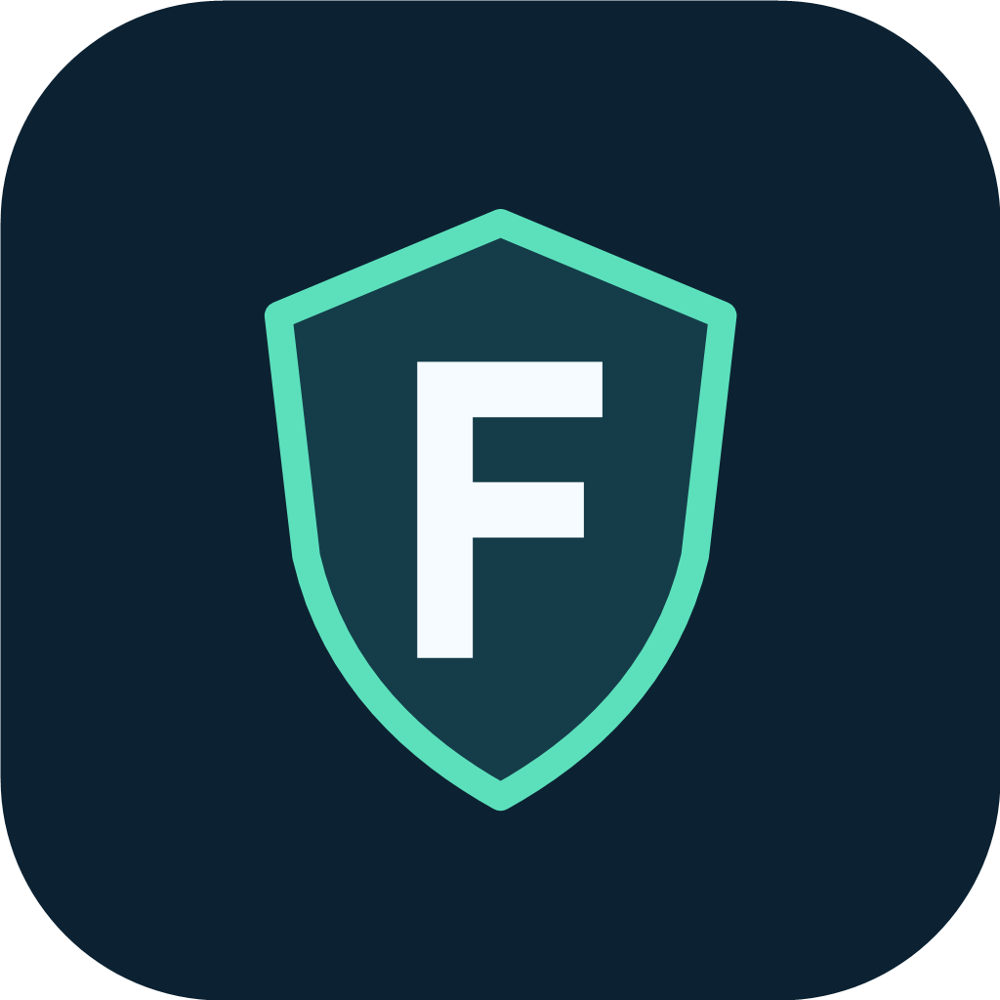

# Cryptomator Free

**非官方、独立维护的开源修改版。与 Cryptomator / Skymatic 官方无隶属关系，未获其背书，也不由官方提供支持。**

**An independent, unofficial fork. Not affiliated with, endorsed by, or supported by Cryptomator, Skymatic, or the upstream maintainers.**

Cryptomator Free 为 Android 提供永久开放读写的加密保险库，支持本地目录、WebDAV 和 S3。无需购买应用授权、订阅或启动试用。上游加密实现和保险库格式未改动。

首个版本为 **0.1.0 预览版**，基于 **Cryptomator Android 2.2.0-SNAPSHOT** 开发代码，准确提交为 [4ebaeb9a3a03929eaf2b6aabfbffef5a5b933756](https://github.com/cryptomator/android/commit/4ebaeb9a3a03929eaf2b6aabfbffef5a5b933756)（2026-11-05），比上游 2.1.0 标签多 70 次提交。**这不是官方 2.2.0 正式版。** 完整来源和修改记录见 [UPSTREAM.md](UPSTREAM.md)。

## 下载与安装

- [Releases：APK、对应源码与 SHA-256 校验值](https://github.com/xO-ox-ai/cryptomator-free-android/releases)
- Android 8.0 或更高版本。
- 应用名称：**Cryptomator Free**。
- 包名：`io.github.xooxai.cryptomatorfree.lite`，可与官方版并存。
- 使用本 fork 独立的发行签名，无法覆盖官方版或早先的 Cryptomator Community 调试测试包。

当前 APK 使用 Lite 功能集，包含**本地目录、WebDAV、S3**，其中包含的功能均永久开放读写。Dropbox、Google Drive、OneDrive、SharePoint、pCloud、Box 等集成未包含在这个 APK 中。

## 离线使用与 Nextcloud

在手机文件管理器中新建一个目录，例如 `Documents/Cryptomator-Free`，再在应用的“本地存储”中选择它。你可以新建保险库，或复制**完整的已有加密保险库**后添加并解锁，离线导入、查看、修改文件。

需要同步时，同步**整个加密保险库目录**，包括配置、主密钥文件和 `d` 目录。不要把解锁后向外部应用提供的明文入口设为云同步源。建议同步完成后再换设备编辑，避免文件冲突。

Nextcloud 安卓版的“自动上传”不等同于桌面端完整的双向文件夹同步。修改、重命名、删除、远端更新和后台运行都应在你的设备上验证。当前版本不支持在 Nextcloud 中直接点击加密文件并自动解密预览；应从 Cryptomator Free 或它提供的 Android 系统文件入口打开文件。

## 本 fork 的修改

- 免费构建永久获得读写权限，试用到期不再限制操作；不生成或伪造官方许可证。
- 跳过购买和试用引导，停用购买服务、官方促销和官方 APK 自动更新。
- 使用新图标和独立包名、签名；首次启动页和设置明确显示非官方说明与上游提交。
- 保留原作者版权、开源许可证、依赖声明和保险库格式。

编译及签名见 [BUILDING.md](BUILDING.md)。本 fork 的界面和许可证行为修改于 **2026-11-10**。这是预览版本：本地编译、相关单元测试、APK 签名和安装包结构已验证，**尚未完成安卓真机及 Nextcloud 同步测试，也未接受独立安全审计**。

## English

Cryptomator Free provides permanent read/write access to encrypted vaults on Android. The initial APK supports local folders, WebDAV, and S3. It does not require an app license, subscription, or trial. Encryption and the vault format are inherited unchanged from the exact upstream baseline documented in [UPSTREAM.md](UPSTREAM.md).

Version 0.1.0 is a preview based on upstream **2.2.0-SNAPSHOT**, not an official stable release. Install it alongside the official app using package `io.github.xooxai.cryptomatorfree.lite`. The fork has its own artwork, package identity, signing key, issue tracker, and release channel. Read [BUILDING.md](BUILDING.md) to build from source. Device testing is still needed.

## 许可证、归属与支持

原项目采用 GPLv3 / 商业双重许可；本 fork 使用开源许可路径，保留 [GPLv3 原文](LICENSE.txt) 和上游历史。CryptoLib 2.2.0 使用 **AGPLv3**；还需遵守各依赖的许可证，见 [THIRD_PARTY.md](THIRD_PARTY.md) 及应用内许可证页面。新增代码和原创图标以 GPLv3 提供，但不替代依赖库的许可条件。

Cryptomator 名称用于标明项目来源和格式兼容性，不代表获得官方商标授权或背书。原作者保留其作品版权。原项目说明保存在 [docs/UPSTREAM-README.md](docs/UPSTREAM-README.md)。

请在[本仓库 Issues](https://github.com/xO-ox-ai/cryptomator-free-android/issues)反馈本 fork 的问题，勿向官方支持团队提交本 fork 的故障。感谢 [Cryptomator 原作者及贡献者](https://github.com/cryptomator/android/graphs/contributors)；你也可以[支持上游项目](https://cryptomator.org/)。
